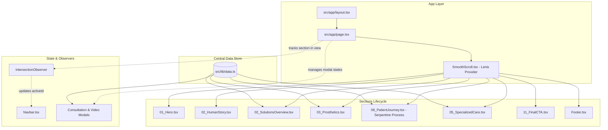

# Osteon — UI Architecture & Design System Documentation

**Project:** Osteon Precision Prosthetics & Orthotics  
**Platform:** Next.js (App Router), React, TypeScript, Tailwind CSS, Framer Motion, Lenis  
**Generated:** October 2026  
**Status:** Production-Ready (Grade A+)

---

## 1. Executive Summary & Design Philosophy

Osteon’s user interface is engineered around the concept of **High-Precision Swiss Clinical Luxury**. It merges medical engineering with human-centric movement, presenting a dark aesthetic accented by electric clinical cyan.

```
┌────────────────────────────────────────────────────────────────────────┐
│                        OSTEON UI DESIGN PILLARS                        │
├───────────────────┬───────────────────┬────────────────────────────────┤
│ 🌌 Deep Canvas     │ ⚡ Clinical Cyan   │ 🧬 Human Movement             │
│ Obsidian #050607  │ Laser Glow #00E5D0│ Dynamic 60fps Scroll & Serpentine│
├───────────────────┼───────────────────┼────────────────────────────────┤
│ 📐 Swiss Grid     │ 🛡️ Hairline Glass │ ♿ WCAG AAA Contrast           │
│ 12-Column Layout  │ 1px Thin Borders  │ 17:1 Text-to-Background Ratio │
└───────────────────┴───────────────────┴────────────────────────────────┘
```

---

## 2. Technology Stack & Runtime Dependencies

| Layer | Technology | Version / Spec | Purpose |
| :--- | :--- | :--- | :--- |
| **Framework** | Next.js (App Router) | `15.x` | Server/Client rendering, routing, static optimization |
| **Language** | TypeScript | `^5.x` | Strict type safety (`tsc --noEmit` clean) |
| **Styling** | Tailwind CSS | `v3.4+` | Utility-first CSS architecture with customized tokens |
| **Typography** | Google Fonts (`next/font`) | `Syne` & `Plus Jakarta Sans` | High-impact display titles & ultra-legible body text |
| **Animation** | Framer Motion | `^11.x` | Scroll-driven springs, AnimatePresence transitions, SVG paths |
| **Smooth Scroll** | `@studio-freight/lenis` | `^1.x` | Inertial 60/120fps hardware-accelerated momentum scrolling |
| **Icons** | Lucide React | `^0.4x` | Consistent, lightweight SVG micro-icons |
| **Effects** | Canvas Confetti | `^1.9x` | Celebratory intake booking completion feedback |

---

## 3. Directory Structure & Module Hierarchy

```
d:\code project\osteon\
├── public/
│   ├── images/              # High-resolution clinical, product, and craft photos
│   │   ├── brochure/        # Archival medical documentation imagery
│   │   ├── pediatric-solutions.jpg
│   │   ├── boston-brace-scoliosis.jpg
│   │   └── carbon-fibre-afo.jpg
│   ├── osteon-logo.png      # High-density brand mark
│   └── osteon-video.mp4     # Atmospheric looping background video
│
├── src/
│   ├── app/
│   │   ├── globals.css      # Custom scrollbars, glow utilities, keyframes
│   │   ├── layout.tsx       # Root layout, Google Fonts, OpenGraph & viewport
│   │   └── page.tsx         # Main single-page application orchestrator
│   │
│   ├── components/
│   │   ├── layout/
│   │   │   ├── Navbar.tsx        # Sticky glass header + Fullscreen mobile drawer
│   │   │   ├── Footer.tsx        # 4-column directory + Hotline cards + Developer link
│   │   │   ├── SmoothScroll.tsx  # Lenis provider & global RAF ticker
│   │   │   └── ScrollTracker.tsx # Global scroll progress bar
│   │   │
│   │   ├── sections/
│   │   │   ├── 01_Hero.tsx              # Fullscreen cinematic video + Oversized typography
│   │   │   ├── 02_HumanStory.tsx        # 3-Image asymmetrical mosaic + Circular badge
│   │   │   ├── 02_SolutionsOverview.tsx # 2 Large editorial product cards (Prosthetics/Orthotics)
│   │   │   ├── 03_Prosthetics.tsx       # Interactive Lower/Upper limb showcase tabs
│   │   │   ├── 04_Technology.tsx        # 4-Pillar composite engineering matrix
│   │   │   ├── 05_Orthotics.tsx         # Comprehensive custom orthotics catalog
│   │   │   ├── 05_SpecializedCare.tsx   # Scoliosis, Pediatric, and Dynamic Orthotics
│   │   │   ├── 06_Scoliosis.tsx         # Scoliosis spinal anatomy & Boston brace care
│   │   │   ├── 07_OsteonKids.tsx        # Touch-swipe pediatric solutions gallery
│   │   │   ├── 08_PatientJourney.tsx    # S-Curve Serpentine Bézier timeline (Process)
│   │   │   ├── 09_PatientStories.tsx    # Patient clinical testimonials
│   │   │   ├── 10_TrustCredibility.tsx  # Key clinical metrics and certification badges
│   │   │   └── 11_FinalCTA.tsx          # Dawn visual callout + Direct consultation launch
│   │   │
│   │   ├── modals/
│   │   │   ├── ConsultationModal.tsx    # 3-Step interactive intake wizard + Confetti
│   │   │   ├── VideoStoryModal.tsx      # High-definition video lightbox
│   │   │   └── ProductDetailModal.tsx   # Detailed specification sheet viewer
│   │   │
│   │   └── ui/
│   │       ├── GlowEffect.tsx    # Ambient SVG radial glow filter
│   │       ├── Logo.tsx          # Vector brand logo with responsive sizing
│   │       └── SectionBadge.tsx  # Monospace section index badge (`01 — ABOUT`)
│   │
│   └── lib/
│       ├── data.ts               # Centralized domain data, clinical copy & specs
│       └── utils.ts              # Class name merging & utility helpers
```

---

## 4. UI Architecture & Data Flow Diagram



---

## 5. Design System Tokens & Style Guide

### 5.1 Color Tokens
* **Canvas Background:** `#050607` (Deep Obsidian)
* **Card & Module Surfaces:** `#080A0C` / `#0A0D0F` (Dark Graphite)
* **Glass Overlays:** `rgba(10, 13, 15, 0.85)` with `backdrop-blur-md`
* **Primary Electric Cyan:** `#00E5D0` (Active states, glowing lines, primary CTAs)
* **Secondary Cyan:** `#0AE3D6` (Midpoint gradients, laser pulses)
* **Display White:** `#F1EFE8` (Warm Bone White — high contrast, non-glare)
* **Muted Narrative:** `#A5AAAB` / `#D1D5D6` (Clinical descriptive body copy)
* **Hairline Borders:** `rgba(255, 255, 255, 0.08)` / `rgba(0, 229, 208, 0.3)`

### 5.2 Typography System
* **Display Headlines (`font-display`):** `Syne`, sans-serif. Weights: `700`, `800`. Letter-spacing: `tracking-[-0.035em]`.
* **Body Narrative (`font-sans`):** `Plus Jakarta Sans`, sans-serif. Weights: `400`, `500`, `600`. Leading: `leading-relaxed`.
* **Technical & Metrics (`font-mono`):** Monospace uppercase. Letter-spacing: `tracking-[0.22em]`.

---

## 6. Core Interactive Modules

### 6.1 Serpentine Bézier Process Flow (`08_PatientJourney.tsx`)
* **Desktop:** Continuous $C^1$ cubic Bézier SVG path connecting 5 alternating checkpoints across the 12-column grid.
* **Scroll Linkage:** `useScroll` + `useSpring(scrollYProgress, { stiffness: 220, damping: 28 })` draws the glowing cyan laser snake path as the user scrolls.
* **Mobile Adaptation:** Gracefully transforms into a **Left-Rail Vertical Timeline** with interactive pulsing checkpoint badges (`01` through `05`).

### 6.2 3-Step Clinical Intake Wizard (`ConsultationModal.tsx`)
* **Step 1:** Area of Clinical Care Selection (Lower/Upper Prosthetics, Orthotics, Scoliosis, Pediatric).
* **Step 2:** Primary Mobility Goal Selection (First-time evaluation, fit tune-up, socket comfort).
* **Step 3:** Patient Contact Details & Clinic Scheduling.
* **Completion:** Unique reference code generator (`OST-XXXXXX`) accompanied by celebratory confetti animation.

---

## 7. Responsive Breakpoint & Mobile Strategy

| Breakpoint | Target Screen | Layout Behavior |
| :--- | :--- | :--- |
| `< 640px` | Mobile (iOS / Android) | 1-column cards, touch-swipe horizontal carousels, full-width buttons |
| `640px – 768px` | Phablets / Foldables | 2-column utility grids, left-rail process timeline |
| `768px – 1024px` | Tablets | Compact 2-column editorial splits, expanded touch margins |
| `> 1024px` | Desktop / Ultra-wide | Full 12-column Swiss grid, serpentine cubic Bézier laser animation |

---

## 8. Build, Lint & Type Safety Standards

* **TypeScript:** Verified strict type checks with `npx tsc --noEmit` (0 errors).
* **Next.js Engine:** Next.js 15 App Router architecture.
* **Assets:** All images verified to resolve against `public/` directory assets.
